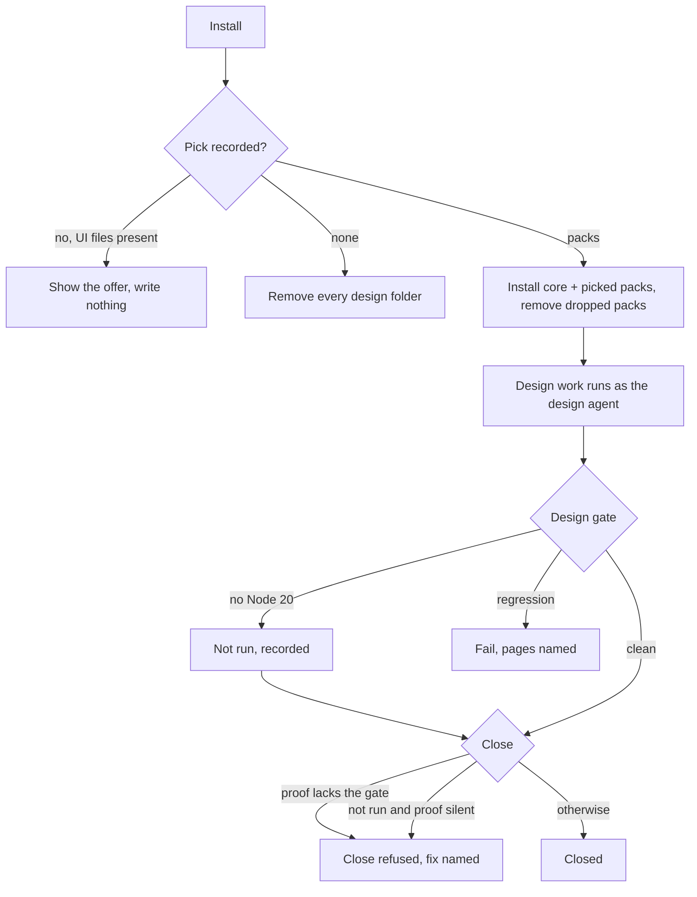

# Onboarding — Design Packs, the Design Role, and the Design Gate

bee carries a body of design taste — curated knowledge about color, type,
spacing, accessibility, content, charts, motion and native platforms — taken
from the design-os project under its licensor's consent (design-os-in-bee D1;
design-os-in-bee D2). A project that builds user interfaces can pick the parts it needs, give UI
work to a dedicated design member of the team, and have every UI change proved
against a saved baseline before it may close.

## Behaviors & Operations

**The taste ships whole, but reaches a project only by pick.** bee's
distribution holds one core taste set and five packs: web, charts, motion,
Apple native platforms, and Figma (design-os-in-bee D1, D4). None of them is
part of the always-installed skill set, so a project that picks nothing
receives nothing.

**Picking packs.** At install the project records its pick as a list of pack
names, or as "none". The core set is installed whenever at least one pack is
picked, beside each picked pack, in every skill home of the project. An unknown
pack name is refused before anything is written, and the refusal lists the
valid names (design-os-in-bee D4).

**Picking at install time.** Both installers accept the pick and pass it to
every onboarding step, so a fresh install can carry it in one run. After a
successful install the installer shows onboarding's notices, the design offer
among them. A plugin-based install, which copies no other skill into the
project, still copies the core set and the picked packs, and still removes
dropped ones (owner decision 1dd050b7).

**Dropping a pack.** When a later install's pick no longer names a pack, that
pack's folder is removed from the project, like any other bee-owned skill. A
project's own skills are never touched, whatever their names. Picking "none"
removes every design folder.

**The offer.** A project with interface files (web pages, style sheets, or
component files) and no recorded pick is shown one plain offer on each install:
what the packs are, how to pick, and a warning that bee replaces edits inside
its design folders on every install. The offer writes nothing and stops once a
pick, including "none", is recorded.

**The design member of the team.** The team has a design role
(design-os-in-bee D3). A unit of work whose role is design runs as the design agent: it loads the
core taste and the installed packs before writing interface code, follows the
taste's workflow, and proves its work with the design gate. With no taste
installed it says so and works as a plain executor. A read-only job that asks
for the design role keeps a read-only agent. Projects that already use bee gain
the design role once on their next install; a project that deletes the role
does not get it back.

**The design gate.** One command runs the design-os checker on each page of the
project and compares the result with a saved baseline (design-os-in-bee D5). A
page with no baseline entry must have no errors; a known page may not gain
errors; the share of the page styled with the project's own design tokens may
not fall. A clean run exits successfully with one summary line; a regression
fails and names each page with its numbers. Recording a new baseline is a
person's act: it is refused while any unit of work is in flight.

**When the checker cannot run.** The checker needs Node 20 or newer. Without
it the gate prints `design gate: not run — Node 20 or newer is missing`, records
that it did not run, and succeeds, so work does not jam (owner answer recorded
2026-10-24).

**The close rule for interface work.** Only in a project that picked at least
one pack (owner answer recorded 2026-10-24), a unit of work that changes
interface files must name the design gate in its approved proof command, or its
close is refused with the fix named (design-os-in-bee D6). When the last gate
run recorded that it did not run, the close is accepted only if the proof says
the design gate did not run, so the gap stays on the record. A unit of work that
lists the baseline file is refused in every project. Creating such a unit of
work without the gate in its proof prints a warning and never refuses.

## Rules

- A pack not picked is never written into a project.
- The baseline only moves by a person's explicit act, never inside a unit of
  work.
- The close rule never binds in a project with no pick.

## Open Gaps

- What a page is in a project that renders its interface from components with
  no static page files: the gate checks the configured page list; producing
  pages from a build is the project's to wire.
- The design-os license text calls the project MIT in one file and PolyForm
  Shield 1.0.0 in another; bee carries both verbatim.

## Pointers

- Taste: `packages/bee/design/` (core `bee-design`, packs `bee-design-*`,
  `LICENSE.md`, `THIRD_PARTY_LICENSES.md`, `UPSTREAM.json`); refresh with
  `scripts/sync-design-os.sh`.
- Pick, install, prune, offer, role upgrade: `packages/bee-rs/crates/bee/src/onboard/`
  (`source.rs` design root, `skills.rs` sources, `plan.rs`, `apply.rs`,
  `notices.rs`, `templates.rs` `DESIGN_PACKS_OFFER`); flag `--design-packs`;
  host config keys `design.packs`, `design.pages`, `design.ui_globs`.
- Installers: `scripts/install.sh --design-packs`, `scripts/install.ps1
  -DesignPacks`; plugin-first design copy `compute_design_sync` in
  `onboard/skills.rs`, called from `onboard/plan.rs`.
- Design agent: `packages/bee/agents/bee-design.md.tmpl`; pin in
  `verbs/drivers/prepare.rs`; `ROLE_AGENTS` in `verbs/drivers/guard.rs`;
  `DESIGN_CELL_PREAMBLE` in `verbs/drivers/prompt.rs`.
- Gate: `bee design gate`, `verbs/design_group.rs`; baseline
  `.bee/design/gate-baseline.json`; run record `.bee/design/last-run.json`;
  test overrides `BEE_DESIGN_OS_CLI`, `BEE_DESIGN_NODE_BIN`.
- Close rule: `verbs/cells/design_rule.rs`, called from `handlers_close.rs` and
  `handlers_write.rs`.
- Decisions: b99dde04, 961426b5, 572bc11e, d5399608, 587bcc85, f4bbb166,
  c86c235c, 053a14a4.
