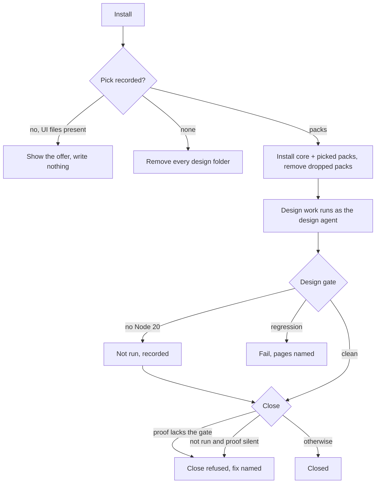

# Onboarding — Design Packs, the Design Role, and the Design Gate

bee carries a body of design taste — curated knowledge about color, type,
spacing, accessibility, content, charts, motion and native platforms — taken
from the design-os project under its licensor's consent (design-os-in-bee D1;
design-os-in-bee D2). A project that builds user interfaces can pick the parts it needs, give UI
work to a dedicated design member of the team, and have every UI change proved
against a saved baseline before it may close.

## Behaviors & Operations

**The taste ships whole, but reaches a project only by pick.** bee's
distribution holds one core taste set and five packs: web, charts, motion,
Apple native platforms, and Figma (design-os-in-bee D1, D4). None of them is
part of the always-installed skill set, so a project that picks nothing
receives nothing.

**Picking packs.** At install the project records its pick as a list of pack
names, or as "none". The core set is installed whenever at least one pack is
picked, beside each picked pack, in every skill home of the project. An unknown
pack name is refused before anything is written, and the refusal lists the
valid names (design-os-in-bee D4).

**Picking at install time.** Both installers accept the pick and pass it to
every onboarding step, so a fresh install can carry it in one run. When no pick
was given, the installer reads `design_offer` from onboarding's preview — true
when the project has interface files and no recorded pick, from the same check
that drives the offer notice. An interactive install then asks the person once
which packs to add (Enter skips; an unknown name is refused by onboarding
before anything is written). With `--yes`, with no terminal, or on a dry run it
asks nothing and prints one plain line naming `--design-packs` (decision
7cbfad00). After a successful install the installer shows onboarding's
notices, the design offer among them. A plugin-based install, which copies no other skill into the
project, still copies the core set and the picked packs, and still removes
dropped ones (owner decision 1dd050b7).

**Dropping a pack.** When a newer install's pick no longer names a pack, that
pack's folder is removed from the project, like any other bee-owned skill. A
project's own skills are never touched, whatever their names. Picking "none"
removes every design folder.

**The offer.** A project with interface files (web pages, style sheets, or
component files) and no recorded pick is shown one plain offer on each install:
what the packs are, how to pick, and a warning that bee replaces edits inside
its design folders on every install. The offer writes nothing and stops once a
pick, including "none", is recorded.

**The design member of the team.** The team has a design role
(design-os-in-bee D3). A unit of work whose role is design runs as the design agent: it loads the
core taste and the installed packs before writing interface code, follows the
taste's workflow, and proves its work with the design gate. With no taste
installed it says so and works as a plain executor. A read-only job that asks
for the design role keeps a read-only agent. Projects that already use bee gain
the design role once on their next install; a project that deletes the role
does not get it back.

**The design gate.** One command runs the design-os checker on each page of the
project and compares the result with a saved baseline (design-os-in-bee D5). A
page with no baseline entry must have no errors; a known page may not gain
errors; the share of the page styled with the project's own design tokens may
not fall. A clean run exits successfully with one summary line; a regression
fails and names each page with its numbers. Recording a new baseline is a
person's act: it is refused while any unit of work is in flight.

**Charts, diagrams, flows and motion sections.** The gate also checks the
files that design-os's own dedicated checkers own, found by the marks those
checkers expect (design-os-checks D6): a page whose chart root carries
`data-chart-owned="true"`, a page whose diagram root carries
`data-diagram-owned="true"`, a page with an embedded scroll section (an
element of class `scrub`), and a screen-flow model named `flow.json` or
`<name>.flow.json`. Each is held to the saved baseline like a page: it may not
gain errors, and a new one must have none (design-os-checks D7). Clip
encoding and scroll capture checks stay manual (design-os-checks D8). A project with none of these files sees the
same output as before.

**When the checker grows.** The baseline remembers which groups of checks it
counted (design-os-checks D9). When a newer checker adds a group — ease-design 0.6.2 added the
design-system usage group — the gate compares only the groups the baseline
knows and prints one note naming the new group and the command to re-record.
A baseline saved before chart and diagram checking existed treats their errors
the same way (design-os-checks D12). The note never fails the run. Once a person re-records,
every group and every chart, diagram, flow and motion file counts in full.

**Command lists per pack.** Each pack that runs design-os commands carries
its own list of the commands it may run, generated from the pinned tool, with
the commands it mentions but must not run in a project named apart (design-os-checks D3/D4/D5).
A suite check fails when a pack mentions a command no list covers.

**bee's own additions to a pack.** Content bee writes for a pack, not taken
from design-os, lives in the pack's own additions folder and is linked from the
pack's skill page (decision e37c2be9). The refresh from design-os deletes and
re-copies the upstream reference folder each time, so a bee file placed there
is lost on the next refresh. The additions so far: six WCAG 2.2 rules design-os
lacks, ported from ui-ux-pro-max-skill under MIT — focus not obscured, a drag
alternative, accessible login, a pause for auto-rotation, scrim contrast on the
real background, and an error summary that takes focus (decision e7b47aa2); the
fresh-context critic's brief — frames only, the closest gold example beside
them, ranked findings; and, in the motion pack, frame rehearsal scripts
ported from Stageshow under MIT — the contact sheet, the jump and drift scan,
and the box-fit check, without the parts bound to Stageshow's own kit
(decision 967bd7a2).

**The frame check for a page that moves.** A still shot cannot show a jump, so
a page with an animation, a transition, scroll-driven motion or a hover state
gets a frame check in the design workflow's Check step (decision 741aef06).
When the motion pack is installed, a browser is available and the project has
a headless browser driver, the design agent makes a contact sheet of the page's
frames, looks at every frame, and runs a strict jump scan. A jump is a box that
moves or resizes more than 2 px in one frame while it is still in the frames
before and after (decision f55afb46). Every jump is fixed before hand-over.
When any of the three is missing, the agent installs nothing and lists motion
as not verified, naming what was missing. The hand-over always carries a motion
field: the sheet and the jump result, no motion, or not checked and why.
Each rehearsal script exits 0 on a pass, 1 on findings only in strict mode, and
2 when the run is incomplete.

**When the checker cannot run.** The checker needs Node 20 or newer. Without
it the gate prints `design gate: not run — Node 20 or newer is missing`, records
that it did not run, and succeeds, so work does not jam (owner answer recorded
2026-10-24).

**The close rule for interface work.** Only in a project that picked at least
one pack (owner answer recorded 2026-10-24), a unit of work that changes
interface files — screen-flow models included (design-os-checks D10) — must name the design gate in its approved proof command, or its
close is refused with the fix named (design-os-in-bee D6). When the last gate
run recorded that it did not run, the close is accepted only if the proof says
the design gate did not run, so the gap stays on the record. A unit of work that
lists the baseline file is refused in every project. Creating such a unit of
work without the gate in its proof prints a warning and never refuses.

## Rules

- A pack not picked is never written into a project.
- The baseline only moves by a person's explicit act, never inside a unit of
  work.
- The close rule never binds in a project with no pick.
- bee's own pack content never lives in a folder the design-os refresh
  replaces.

## Open Gaps

- What a page is in a project that renders its interface from components with
  no static page files: the gate checks the configured page list; producing
  pages from a build is the project's to wire.
- The design-os license text calls the project MIT in one file and PolyForm
  Shield 1.0.0 in another; bee carries both verbatim.
- The core taste's own references name design-os commands outside the core
  command list (backlog p-982de3cf).
- The gate's machine-readable output names uncounted check groups only in its
  text lines, not as a field of their own.
- A project that sets its own interface file patterns does not gain the
  screen-flow patterns; it adds them itself.

## Pointers

- Taste: `packages/bee/design/` (core `bee-design`, packs `bee-design-*`,
  `LICENSE.md`, `THIRD_PARTY_LICENSES.md`, `UPSTREAM.json`); refresh with
  `scripts/sync-design-os.sh` — pinned at ease-design 0.6.2, upstream commit
  `369b041` (design-os-checks D1/D2) — which also renders each pack's
  `references/contract.md` through `scripts/design-os-contract.mjs`.
- Pick, install, prune, offer, role upgrade: `packages/bee-rs/crates/bee/src/onboard/`
  (`source.rs` design root, `skills.rs` sources, `plan.rs`, `apply.rs`,
  `notices.rs` `design_offer_due`, `templates.rs` `DESIGN_PACKS_OFFER`); flag
  `--design-packs` (declared in `generated/registry_payload.json`); JSON field
  `design_offer`;
  host config keys `design.packs`, `design.pages`, `design.ui_globs`.
- Installers: `scripts/install.sh --design-packs`, `scripts/install.ps1
  -DesignPacks`; plugin-first design copy `compute_design_sync` in
  `onboard/skills.rs`, called from `onboard/plan.rs`.
- Design agent: `packages/bee/agents/bee-comb.md.tmpl`; pin in
  `verbs/drivers/prepare.rs`; `ROLE_AGENTS` in `verbs/drivers/guard.rs`;
  `DESIGN_CELL_PREAMBLE` in `verbs/drivers/prompt.rs`.
- Gate: `bee design gate`, `verbs/design_group.rs`; baseline
  `.bee/design/gate-baseline.json`; run record `.bee/design/last-run.json`;
  test overrides `BEE_DESIGN_OS_CLI`, `BEE_DESIGN_NODE_BIN`.
- Close rule: `verbs/cells/design_rule.rs`, called from `handlers_close.rs` and
  `handlers_write.rs`.
- bee's additions: `packages/bee/design/bee-design/additions/wcag-2-2.md` and
  `additions/frame-review.md`; `packages/bee/design/bee-design-motion/additions/frame-rehearsal.md`
  and `additions/rehearse/` (`sheet.mjs`, `jumps.mjs`, `layout.mjs`, their
  `*-core.mjs`, `LICENSE-stageshow.md`, `rehearse.test.mjs`); the wipe they
  avoid is `scripts/sync-design-os.sh`. Frame check and the `MOTION` hand-over
  field: `packages/bee/design/bee-design/SKILL.md` steps 3 and 4.
- Decisions: b99dde04, 961426b5, 572bc11e, d5399608, 587bcc85, f4bbb166,
  c86c235c, 053a14a4, 7cbfad00, e7b47aa2, e37c2be9, 967bd7a2, f55afb46,
  741aef06.
